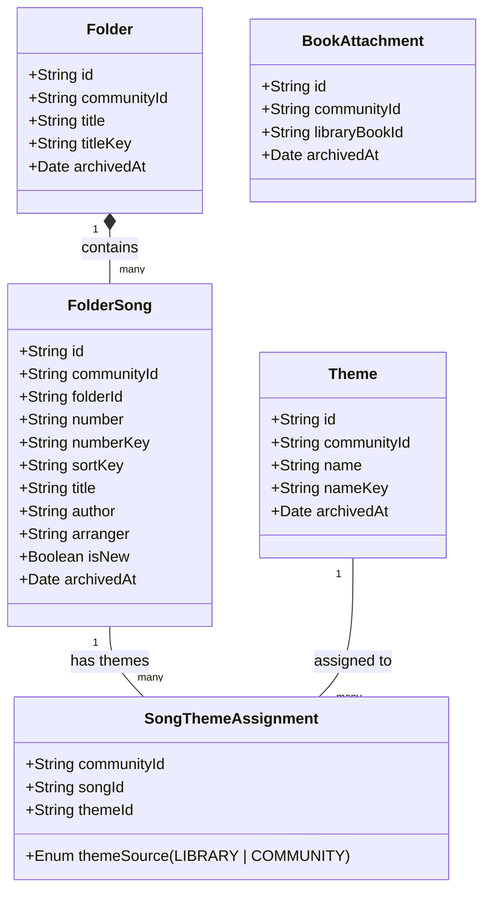
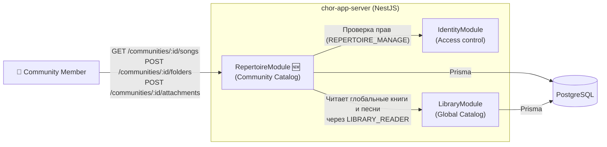
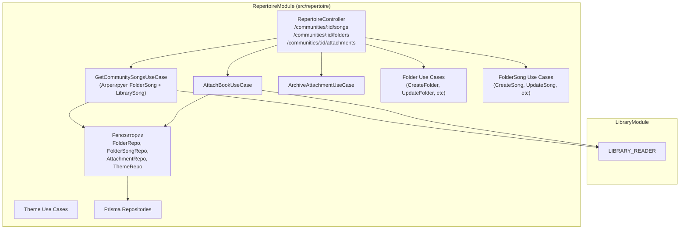
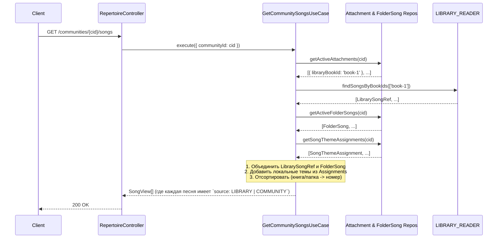

# Catalog Community (Repertoire) — дизайн (фаза 2)

**Дата:** 2026-09-18
**Охват:** Модуль `RepertoireModule` (Catalog Community) на сервере `chor-app-server` для управления репертуаром (прикрепленные глобальные книги, локальные папки/Mappe, локальные песни, локальные темы).
**Статус:** Черновик на ревью.
**Основание:** `CATALOG_COMMUNITY_RESEARCH.md`, ADR 0009.

---

## 1. Концепция и цель

Согласно ADR 0009, Репертуар Сообщества состоит из **Привязанных глобальных книг** (Read-Only) и **Собственных папок сообщества** (Mappe). 
Цель фичи — дать возможность сообществу составлять свой рабочий каталог, переиспользуя стандартизированные печатные издания из `LibraryModule` и дополняя их собственным материалом (Folder / FolderSong).

Структура данных `RepertoireModule` во многом симметрична `LibraryModule` (глобальному каталогу), но:
1. **Каждая сущность имеет `communityId`** и недоступна другим сообществам.
2. У `FolderSong` есть флаг `isNew` (недоступен для глобальных книг).
3. Доступны операции изменения и удаления (архивации) только для локальных папок и локальных песен. Глобальные книги можно только "подключить" или "отключить".

---

## 2. Модель данных (Сущности)

> **Примечание:** В `SongThemeAssignment` поле `songId` может указывать как на локальный `FolderSong`, так и на глобальный `LibrarySong`. Это позволяет присваивать локальные темы и глобальным печатным песням в контексте одного сообщества.

---

## 3. C4 Уровень 2: Контейнеры

---

## 4. C4 Уровень 3: Компоненты API (`RepertoireModule`)

---

## 5. DFD (Поток данных): Запрос списка песен сообщества

---

## 6. Ключевые решения и API Контракты

### 6.1 API Привязок книг (BookAttachment)
- `GET /communities/:communityId/attachments`
- `POST /communities/:communityId/attachments` (body: `{ libraryBookId }`)
- `POST /communities/:communityId/attachments/:attachmentId/archive`

### 6.2 API Пользовательских папок (Folders / Mappe)
- `GET /communities/:communityId/folders`
- `POST /communities/:communityId/folders` (body: `{ title }`)
- `PATCH /communities/:communityId/folders/:folderId`
- `POST /communities/:communityId/folders/:folderId/archive`

### 6.3 API Пользовательских песен (FolderSongs)
- Относятся к конкретной папке.
- `POST /communities/:communityId/folders/:folderId/songs` (body: `{ number, title, author, arranger, isNew, themeIds }`)
- `PATCH /communities/:communityId/folders/:folderId/songs/:songId`
- `POST /communities/:communityId/folders/:folderId/songs/:songId/archive`

### 6.4 API Тем и Присвоений (Themes & Assignments)
Темы сообщества управляются через:
- `GET /communities/:communityId/themes` (вернёт `LibraryTheme` от привязанных книг + `Theme` сообщества)
- `POST /communities/:communityId/themes`
Привязка тем к ЛЮБОЙ песне (даже глобальной) идёт через отдельный эндпоинт в репертуаре:
- `PUT /communities/:communityId/songs/:songId/themes` (перезаписывает массив локальных тем песни).

### 6.5 Права доступа
Все эндпоинты защищены `CommunityMemberGuard`.
Операции изменения (POST, PATCH) требуют наличия разрешения `REPERTOIRE_MANAGE` в роли участника сообщества. Чтение доступно всем членам сообщества.
